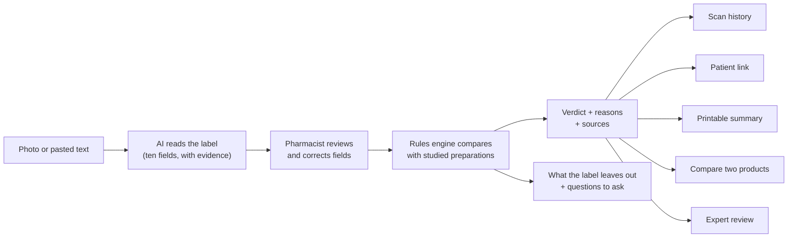
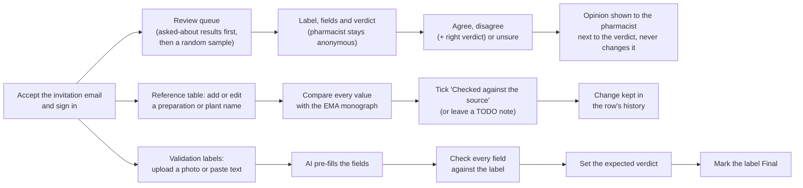
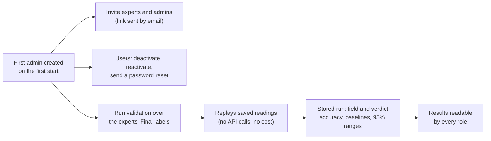
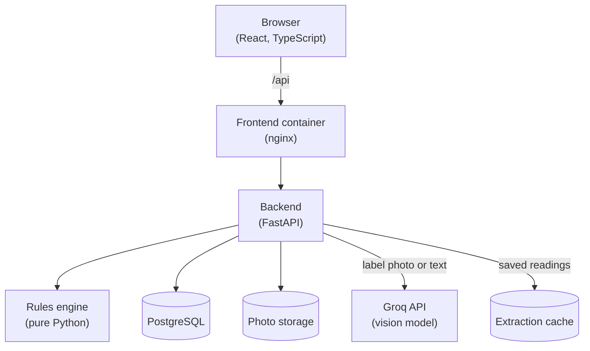

# LabelLens

**Does the evidence for this herb apply to this product?**

> Research prediction, not medical advice. This checks the label, not what is inside the product.
> LabelLens gives no dosing or treatment advice.

## Overview

Studies say a herb helped, but only for the exact preparation they tested: a given plant part,
extract type, extract ratio and solvent. A shop product that just says "St John's wort" may be a
different preparation, so the evidence may not apply to it.

LabelLens helps pharmacists check this. A pharmacist photographs a herbal product's label;
LabelLens reads it, compares it with the preparations studied in EU herbal monographs, and returns
one of four answers:

- **Matches a studied preparation**
- **Partly matches**
- **Cannot say whether the evidence applies**
- **Not yet covered**

It also lists what the label leaves out, with a question to ask for each, and links every claim to
its source. It never judges whether a product is harmless or right for someone, and it never
treats missing information as good news.

Built for EthnoHack 2026, Track 4 (digital health and phytotherapy). Status: working prototype.
The reference data is a set of source-linked draft rows that have not been verified by an expert.

**Live demo:** https://13-60-219-35.sslip.io (hosted on Amazon Lightsail). Pharmacists can register there;
expert and admin accounts are by invitation.

## Features

- **Scan:** upload a label photo (JPG or PNG) or paste label text.
- **AI label reading:** a vision model copies what is printed on the label into ten fields, each
  with a confidence and the exact label text it came from. Values that are not printed stay "not
  stated"; the reader never guesses.
- **Pharmacist review:** the pharmacist checks and corrects every field before anything is compared.
- **Evidence check:** rules (not the AI) compare plant, plant part, preparation, extract ratio and
  solvent with the studied preparations, and give the verdict with reasons and source links.
- **What the label leaves out:** a checklist of missing details with a question for the
  manufacturer or the patient, which can be copied.
- **History:** every scan and every dated verdict is kept; a saved scan can be checked again
  against the current reference table.
- **Compare two products:** two checked scans side by side, showing which label fields differ. It
  never ranks the products.
- **Patient link and summary:** a short link in plain language that expires and can be revoked, and
  a printable one-page summary.
- **Expert work:** experts review verdicts (without seeing who scanned), maintain the reference
  table with a change history, and build the validation labels.
- **Admin tools:** users, invitations and validation runs.
- **Roles:** pharmacist, expert and admin. English only, light and dark theme.

## Installation / Setup

The steps below run LabelLens on your own machine. The live demo above is deployed on Amazon Lightsail and
served over HTTPS.

Requirements: Docker with Compose v2.

```bash
cp .env.example .env   # then fill in the empty values
docker compose up --build
```

The empty values in `.env`:

| Value | What it is |
| --- | --- |
| `POSTGRES_PASSWORD` | Database password. Generate a random one (command below). |
| `JWT_SECRET` | Signs sign-in sessions; at least 32 characters. Generate a random one (command below). |
| `GROQ_API_KEY` | Key for the label reader, from [GroqCloud](https://console.groq.com/keys). |
| `SMTP_USERNAME`, `SMTP_PASSWORD`, `SMTP_FROM` | The email account that sends invitations, email confirmations and password resets. For Gmail, `SMTP_PASSWORD` is an app password (Google Account → Security → 2-Step Verification → App passwords), not your normal one. |
| `ADMIN_EMAIL`, `ADMIN_NAME`, `ADMIN_PASSWORD` | The first admin account, created on the first start. The name is optional; the password needs at least 12 characters. |
| `DATABASE_URL` | Leave empty: Docker Compose builds it from the `POSTGRES_*` values. |

To generate a random value: `python -c "import secrets; print(secrets.token_urlsafe(32))"`.

- App: http://localhost:8080
- API docs: http://localhost:8000/api/docs

Pharmacists register themselves at `/register`. Expert reviewers and admins are invitation-only.
The first admin is created only if no admin exists yet. Sign in as that admin, open **Admin**, and invite reviewers and more admins by email.

The reference table (studied preparations and plant names) is loaded from
`data/reference/ema-draft.json` on the first start, when the table is empty. After that, experts
edit it in the app.

### Label reading modes

- **Groq (`EXTRACTION_PROVIDER=groq`):** photos and pasted text are read by the Groq-hosted vision
  model set in `GROQ_MODEL` (default `qwen/qwen3.8-27b`), using `GROQ_API_KEY`. The free tier has
  rate limits, so read each demo label once beforehand.
- **Cached (`EXTRACTION_PROVIDER=cached`):** for running without a Groq key. No API is called, and
  only the three example labels on the Scan page can be read.

Every real reading is saved to `data/extraction_cache/` (keyed by input, prompt version and
model), so it can be replayed later and used for validation.

## How it works

1. **Read.** The AI copies the label text into fixed fields (plant, plant part, preparation type,
   extract ratio, solvent, marker, dose, other ingredients, batch, expiry). Each field is
   `stated`, `not_stated` or `unreadable`, and carries a confidence and its evidence text. A stated
   value that does not appear in its evidence is discarded, and that field is marked unreadable
   for the pharmacist to fill in.
2. **Review.** The pharmacist corrects the fields. Corrections are kept in the scan's history.
3. **Compare.** The rules engine looks the plant name up in the plant names table, then compares
   plant part, preparation type, extract ratio and solvent with every studied preparation of that
   plant. Each field is a match, partial match, mismatch, missing or not applicable. Dose and
   marker are shown but not compared.
4. **Answer.** The verdict follows from those comparisons:

   | Verdict | When |
   | --- | --- |
   | Matches a studied preparation | every field fits one studied preparation |
   | Partly matches | one preparation is still possible, nothing contradicts it, but something is less specific |
   | Cannot say whether the evidence applies | two or more preparations are still possible, or the label contradicts them all |
   | Not yet covered | the plant is not in the reference table |

   Two more labels appear on expert and admin screens only:

   - **Differs from every studied preparation:** the label contradicts all of them (for example a
     1:2 extract where the studied one is 35–67:1). Pharmacists see this as "Cannot say", with the
     reason.
   - **Not set:** a validation label whose expected verdict no expert has chosen yet. It is not a
     verdict.

   Every check is stored with the rules version, so old results stay as they were.

The AI reads the label; it never chooses the verdict.

## Project flow

### Pharmacist

Checks a product's label and shares the result.



### Expert

Reviews verdicts, keeps the reference table right and builds the validation labels.



### Admin

Runs the system: accounts and validation runs. Admins don't see pharmacists' scans.



## Visualization



## Validation

Validation measures how often LabelLens is right on labels whose correct answers are known.

1. **Add labels:** as an expert, open **Validation → Validation labels**, upload a label photo or
   paste its text, check every field against the label, set the expected verdict and mark the
   label **Final**. Experts build the answer key, so the team running the system doesn't grade itself.
2. **Run:** as an admin, open **Validation** and click **Run validation**. A run replays saved
   readings only (no API calls, no cost) and is stored, with a copy of the exact answers it was
   scored against.
3. **Read the results** on the Validation page: fields read correctly (including values the
   reader invented), verdict accuracy end to end and with the correct fields, two baselines (keyword
   matching, and a plain AI prompt without our rules), expert agreement, and every mistake. All
   numbers come with a 95% confidence range.

Labels without a saved reading are left out of the field and end-to-end numbers.
`docker compose exec backend python -m app.cli fetch-readings` reads them (and the plain-prompt
baseline) with Groq, pausing 20 seconds between calls for the free tier; the readings are saved
for later runs. Accuracy figures are only quoted from a stored run over Final
labels.

## Data sources and licences

Reference preparations come from EU herbal monographs published by the European Medicines Agency
(Committee on Herbal Medicinal Products, HMPC) and the studies they cite. The reference table in
this repository (`data/reference/ema-draft.json`) contains **seven source-linked draft rows**
(`verified=false`) transcribed from final EMA monographs for St John's wort, ginkgo and German
chamomile. They still need checking by a qualified reviewer. The import refuses unchecked rows
without a `TODO(expert)` note, and the result page says "sample reference data" while any row it
used is unchecked. Coverage is partial: it is not a complete monograph database.

See `DATA_SOURCES.md` for sources and open questions. Code: [MIT licence](LICENSE).

## Repository layout

```
backend/
  app/
    main.py          FastAPI app factory
    config.py        settings from env vars (see .env.example)
    db.py            database engine and session
    cli.py           admin commands (create-admin, seed-admin, import-reference, run-validation,
                     fetch-readings)
    api/             routes (auth, admin, invitations, scans, share links, reviews, reference,
                     annotations, validation, health), auth dependencies, schemas
    models/          SQLAlchemy models
    services/        password hashing, tokens, rate limiting, audit log, file storage, email,
                     validation runs
    extraction/      label reading (Groq provider, cached replay, field schema)
    rules/           rules engine (pure Python, versioned): label fields vs studied preparations
  alembic/           database migrations
  tests/             pytest
frontend/src/
  app/               routes, auth/role guards, navigation per role
  api/               API client and TanStack Query hooks
  components/        layout and UI components
  pages/             one file per screen
  i18n/              UI strings (English)
  theme/             design tokens (CSS variables), theme toggle
data/                reference rows (ema-draft.json, sample.json), saved label readings
validation/results/  JSON copies of validation runs (run-validation --out)
```
## Confidential

- **Not medical advice.** Every page says "Research prediction, not medical advice", and results
  say the label is checked, not the product's contents. There is no dosing or treatment advice.
- **Do not scan personal information.** Labels with patient or personal details should not be
  uploaded.
- **What is stored.** Label photos (turned upright, location and camera data removed), the fields
  read from them, corrections, verdicts and an audit log. Users can delete a scan with its photo,
  delete their whole history, and revoke all their patient links.
- **Third-party processing.** In Groq mode the label photo or text is sent to GroqCloud for
  reading. In cached mode nothing leaves the server.
- **Patient links.** The token sits after `#` in the link, so it never reaches server logs; only
  its hash is stored. Links expire after 24 hours, 7 days or 30 days and can be revoked. A patient
  sees only the product name, the plant and the verdict.
- **Expert review is anonymous.** Experts see verdicts without the pharmacist's name or email.
- **Accounts.** Passwords are hashed with Argon2, sessions last 8 hours (30 days with "Remember
  me") in a secure cookie, self-registered pharmacists confirm their email, login and registration
  are rate limited, and role checks are enforced in the backend.
- **Secrets.** Keys, passwords and tokens live only in `.env`, which is not committed.
  `.env.example` keeps them empty.

## Contributors

Built by the LabelLens team for EthnoHack 2026, Track 4.

- [Zana Ademi](https://github.com/Zanaad) - Team Lead
- [Yllkë Berisha](https://github.com/yllkaberisha) - Software Developer
- [Alketa Zekaj](https://github.com/AlketaZekaj) - DevOps Engineer
